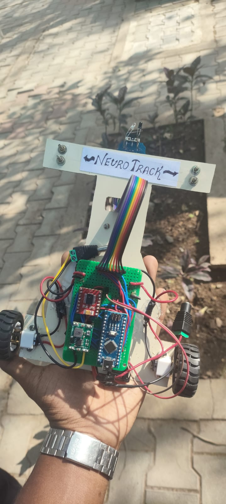
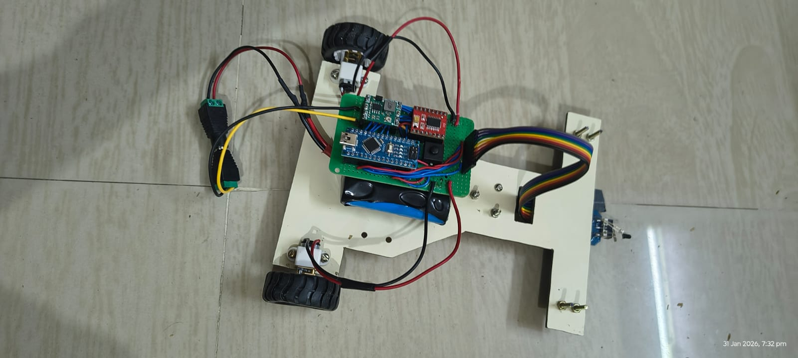

LINE FOLLOWER ROBOT:
An Arduino Nano-based autonomous robot that follows a black line on a white surface using an IR sensor array and an L298N motor driver.

OVERVIEW:
The Line Follower Robot is a robotics project designed to follow a predefined path autonomously. It uses infrared (IR) sensors to detect the line and controls its motors to adjust the robot's direction based on the sensor readings.

HARDWARE COMPONENTS:
- Arduino Nano — main controller
- IR sensor array — line detection
- TB6612FNG motor driver — motor control
- DC motors — robot movement
- Robot chassis(built from scratch) and wheels
- Power supply(li-ion battery)

SOFTWARE AND TOOLS:
- Arduino IDE
- Arduino programming language (C/C++)

WORKING PRINCIPLE:
1. The IR sensor array detects the black line against the white surface.
2. The sensor readings are processed by the Arduino Nano.
3. The Arduino determines the required movement based on the detected line position.
4. The TB6612FNG motor driver controls the DC motors according to the controller's output.
5. The robot adjusts its direction to follow the path.

IMPLEMENTATION:
The robot was assembled using an Arduino Nano, an IR sensor array, and an L298N motor driver. The control program was developed using the Arduino IDE.

RESULT:
The assembled robot was tested on a black-line path over a white surface and successfully followed the line.

APPLICATIONS:
- Introduction to autonomous mobile robotics
- Sensor-based navigation
- Embedded systems learning
- Robotics and automation experiments

FUTURE IMPROVEMENTS:
- Improve line tracking accuracy and turning response
- Test performance at different speeds
- Evaluate operation on curves and intersections
- Document sensor calibration and control logic

ACHIEVEMENTS:
Third prize in Chennai Institute of Technology for line following robot event 
under the technical symposium JARVIS 2026.

PROJECT STATUS:
Completed and tested

AUTHOR:
Mohamed Jazak J
Electronics and Instrumentation Engineering Student

## Project Gallery

### Robot Front View

### Robot Setup

## Testing Demonstration

[Watch the line-following test video](<robot-line following test.mp4>)
